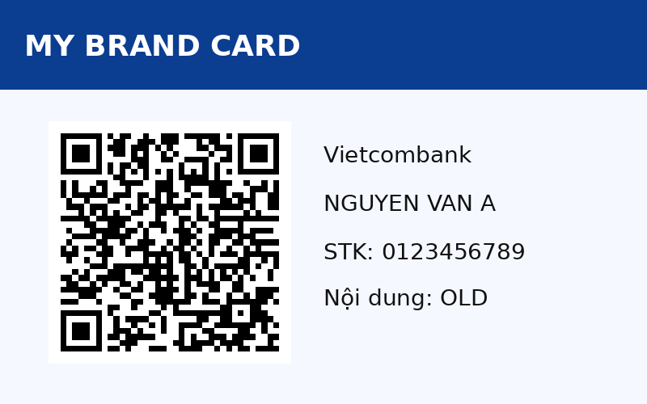
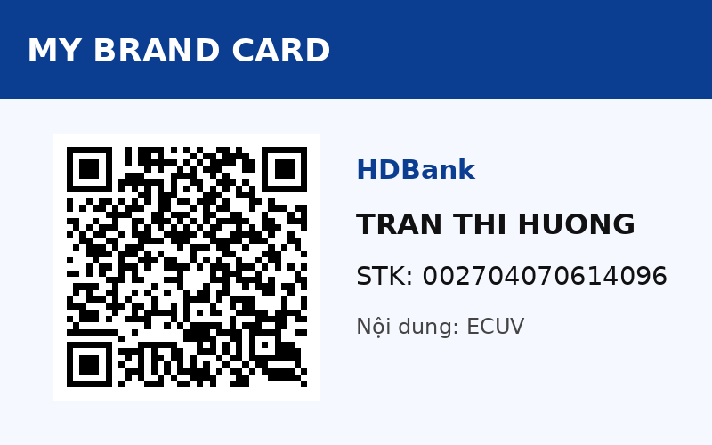
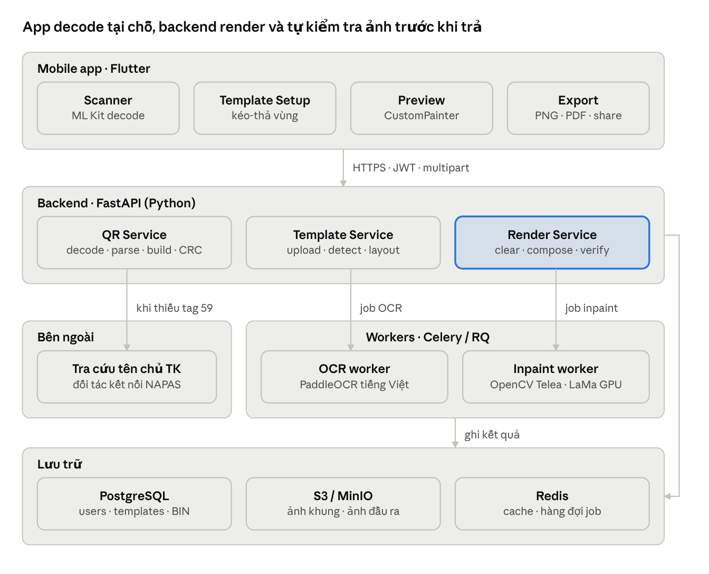

# Smart VietQR Template Generator & Scanner

Quét/tải ảnh mã **VietQR (EMVCo/NAPAS)**, bóc tách thông tin tài khoản, rồi tự động thay mã QR + thông tin mới lên **khung thiết kế của bạn** — đúng vị trí, font, màu.

| Khung mẫu | Sau khi áp QR mới |
| --- | --- |
|  |  |

## Tính năng

- **Scanner:** đọc QR từ camera hoặc thư viện ảnh, parse VietQR → Ngân hàng (BIN), Chủ TK, STK, Nội dung, Số tiền; kiểm tra CRC-16.
- **Dynamic Template Replacer:** khung mẫu có layout JSON (vùng QR/STK/Tên/Nội dung) → xóa nội dung cũ (`fill` / `inpaint`) → render QR chuẩn từ payload + chữ tự co vừa box → **decode lại ảnh đầu ra để xác minh** trước khi trả.
- Text luôn sinh từ dữ liệu QR, không cho nhập STK/BIN tự do — chống tạo thẻ "chữ một đằng, tiền về một nẻo".

## Cấu trúc repo

```
.
├── docs/
│   ├── ARCHITECTURE.md        # Thiết kế đầy đủ: kiến trúc, EMVCo, pipeline, API, UI/UX, bảo mật, lộ trình
│   └── images/                # Sơ đồ kiến trúc, pipeline, ảnh demo
└── backend/
    ├── vietqr_service.py      # FastAPI + OpenCV + Pillow (parser, builder, renderer, API)
    ├── examples/layout_demo.json
    ├── tests/test_vietqr.py
    └── requirements.txt
```

## Chạy backend demo

```bash
cd backend
python -m venv .venv && source .venv/bin/activate
pip install -r requirements.txt
uvicorn vietqr_service:app --reload      # http://127.0.0.1:8000/docs
pytest -q                                # 7 test
```

Ví dụ gọi API:

```bash
# Giải mã ảnh QR
curl -F image=@qr.png http://127.0.0.1:8000/api/v1/qr/parse

# Áp QR mới vào khung
curl -F template=@template.png -F qr_image=@qr.png \
     -F layout="$(cat examples/layout_demo.json)" \
     http://127.0.0.1:8000/api/v1/template/apply-qr -o output.png
```

> Demo dùng font DejaVu có sẵn trên Linux. Production nên dùng font hỗ trợ tiếng Việt đầy đủ (Be Vietnam Pro, Roboto, Inter) — sửa `FONTS` trong `vietqr_service.py`.

## Kiến trúc



Chi tiết: [docs/ARCHITECTURE.md](docs/ARCHITECTURE.md).

## Lưu ý sử dụng

- Nhiều QR ngân hàng **không chứa tên chủ tài khoản** (tag 59). Khi thiếu, tên do người dùng nhập sẽ được gắn cảnh báo "chưa xác thực".
- Chỉ dùng khung thiết kế bạn sở hữu hoặc được chủ thương hiệu cho phép.
