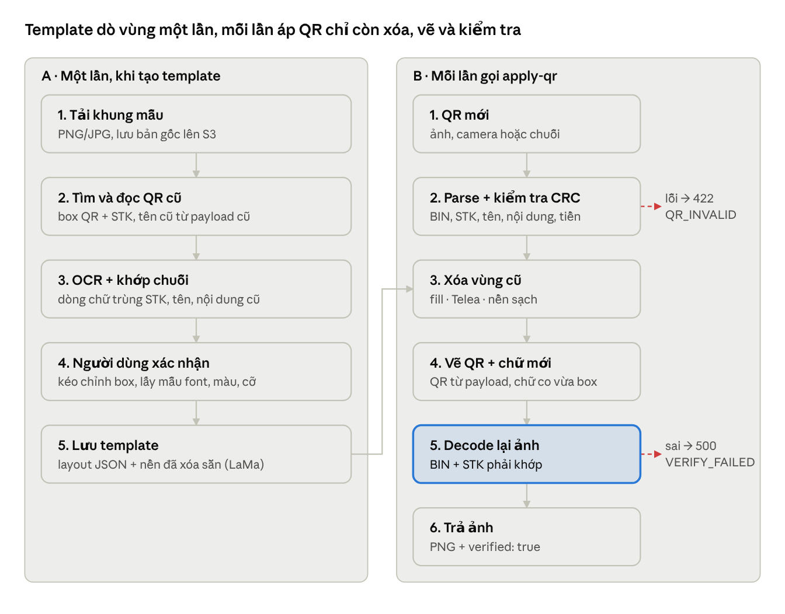

# Smart VietQR Template Generator & Scanner — Kiến trúc & Kế hoạch

## 1. Tóm tắt

Ứng dụng đọc mã VietQR (camera hoặc ảnh), giải mã chuỗi EMVCo, rồi in mã QR mới cùng thông tin tài khoản lên một khung mẫu do người dùng sở hữu. Khuyến nghị: **Flutter** cho app, **FastAPI + OpenCV/Pillow** cho backend, và dùng **template có cấu hình vùng (layout JSON)** thay vì để AI đoán vị trí mỗi lần.

Nguyên tắc thiết kế cốt lõi:

1. **Text luôn sinh ra từ dữ liệu QR đã giải mã** — không cho sửa tay STK/Tên khác với QR. Điều này vừa tránh sai sót, vừa chặn việc tạo thẻ có chữ hiển thị một tài khoản nhưng QR chuyển tiền vào tài khoản khác (kiểu lừa đảo tráo QR phổ biến).
2. **Template là "khuôn" đã khai báo vùng**: QR cũ, STK, Tên, Nội dung được đánh dấu một lần (tự động bằng OCR + QR detect, người dùng xác nhận), lưu thành layout JSON. Các lần áp dụng sau chỉ là render — nhanh, ổn định, không cần inpainting mỗi lần.
3. **Tạo lại QR từ payload, không cắt dán ảnh QR gốc**: QR in ra luôn nét, đúng chuẩn, có CRC hợp lệ.
4. **Chỉ dùng khung thiết kế của chính bạn hoặc được cấp phép**: logo/nhận diện thương hiệu của bên thứ ba (ví dụ Vinclub, ngân hàng) cần có sự đồng ý của chủ thương hiệu.

## 2. Kiến trúc hệ thống & tech stack


App decode QR ngay trên máy để phản hồi tức thì; backend giữ phần nặng (OCR, inpaint, render) và luôn decode lại ảnh đầu ra trước khi trả. Render đơn giản (`clear: fill`) chạy đồng bộ dưới 300 ms; OCR và LaMa chỉ chạy một lần khi tạo template, qua hàng đợi.

| Lớp | Công nghệ | Lý do chọn |
| --- | --- | --- |
| Mobile | Flutter 3, Riverpod, `mobile_scanner`, `image_picker`, `dio`, `share_plus` | Một codebase iOS/Android, `CustomPainter` vẽ preview mượt, camera ML Kit/Vision ổn định |
| API | Python 3.12, FastAPI, Pydantic v2, Uvicorn/Gunicorn | Async, tự sinh OpenAPI cho app, cùng hệ sinh thái OpenCV |
| Xử lý ảnh | OpenCV, Pillow, `qrcode`, zxing-cpp (fallback decode) | Decode/inpaint/compose nhanh, không cần GPU cho luồng chính |
| AI | PaddleOCR (vi) hoặc Google Vision OCR; LaMa inpainting | OCR tiếng Việt có dấu tốt; LaMa xóa chữ trên nền họa tiết |
| Hàng đợi | Celery hoặc RQ + Redis | Tách job nặng khỏi request |
| Lưu trữ | PostgreSQL, S3/MinIO, Redis | Layout JSON (JSONB), ảnh qua URL ký, cache bảng BIN |
| Hạ tầng | Docker, Cloud Run/ECS, Sentry, Prometheus | Scale theo tải, worker GPU tách riêng |

## 3. Bóc tách VietQR (EMVCo)

Chuỗi VietQR là dãy TLV lồng nhau: `Tag(2 số) + Length(2 số) + Value`. Parser tách cấp gốc, rồi tách tiếp tag 38 và 62, cuối cùng kiểm tra CRC.

| Tag | Ý nghĩa | Ví dụ | Trường xuất ra |
| --- | --- | --- | --- |
| 00 | Payload format | `01` | — |
| 01 | 11 = QR tĩnh, 12 = QR động (có số tiền) | `12` | `is_dynamic` |
| 38.00 | GUID NAPAS | `A000000727` | xác nhận là VietQR |
| 38.01.00 | BIN ngân hàng (6 số) | `970437` | `bank_bin` → tra bảng → `bank_short_name` |
| 38.01.01 | Số tài khoản / số thẻ | `002704070614096` | `account_number` |
| 38.02 | `QRIBFTTA` = tài khoản, `QRIBFTTC` = thẻ | `QRIBFTTA` | `service` |
| 53 | Tiền tệ | `704` (VND) | — |
| 54 | Số tiền | `150000` | `amount` |
| 58 | Quốc gia | `VN` | — |
| 59 | Tên chủ tài khoản (tuỳ chọn) | `TRAN THI HUONG` | `account_name` |
| 62.08 | Nội dung chuyển tiền | `ECUV` | `content` |
| 63 | CRC-16/CCITT-FALSE, 4 ký tự hex | `336C` | `crc_valid` |

Ví dụ chuỗi đầy đủ (sinh và kiểm chứng bằng code trong `backend/`):

```
00020101021238590010A0000007270129000697043701150027040706140960208QRIBFTTA530370454061500005802VN5914TRAN THI HUONG62080804ECUV6304336C
```

Lưu ý quan trọng:

- **Tên chủ TK thường KHÔNG có trong QR.** Nhiều app ngân hàng bỏ tag 59. Thứ tự lấy tên: (1) tag 59; (2) API tra cứu tên theo BIN + STK qua đối tác có kết nối NAPAS; (3) người dùng nhập, gắn nhãn "chưa xác thực". BIN và STK luôn lấy từ QR, không cho sửa.
- **CRC tính trên toàn bộ chuỗi tới hết `6304`**. Sai CRC → cảnh báo khi parse, chặn khi xuất ảnh.
- **Bảng BIN** lấy từ danh sách thành viên NAPAS, lưu DB, cập nhật định kỳ (kèm logo, tên ngắn, tên đầy đủ).
- **QR đọc từ ảnh** có thể không phải VietQR (MoMo, ZaloPay, URL…) → trả lỗi `NOT_VIETQR` rõ ràng.

## 4. Pipeline xử lý ảnh



Phần khó (tìm vùng, xóa nền phức tạp) dồn vào luồng A chạy một lần; luồng B dùng lại layout và nền sạch nên nhanh và cho kết quả giống hệt nhau mỗi lần.

**Step 3 — Region detection (luồng A).** Mẹo quan trọng: khung mẫu thường đã chứa một QR cũ hợp lệ. Decode QR cũ → biết chính xác STK/tên cũ là gì → chạy OCR và tìm dòng chữ khớp (so khớp mờ, bỏ dấu cách/dấu tiếng Việt, Levenshtein ≤ 2). Nhờ vậy gán nhãn vùng gần như tự động mà không cần huấn luyện model. Dòng đứng trước như "STK:", "Nội dung:" được nhận làm `prefix`. Box QR nở thêm 4% để xóa cả quiet zone cũ.

**Lấy mẫu style chữ.** Màu chữ = cụm tối nhất của K-means (k=2) trong box; cỡ chữ ≈ chiều cao chữ hoa đo được; đậm/nhạt theo độ dày nét (stroke width transform). Font cụ thể khó đoán chính xác → đề xuất 3 font gần nhất từ thư viện có hỗ trợ tiếng Việt, người dùng chọn.

**Step 4 — Xóa nội dung cũ.** Chọn theo độ phức tạp nền quanh box (đo bằng độ lệch chuẩn màu trên viền):

| Nền | Độ lệch chuẩn viền | Cách xóa | Thời gian |
| --- | --- | --- | --- |
| Phẳng 1 màu | < 8 | `fill`: đổ median màu viền | < 5 ms |
| Gradient nhẹ | 8–25 | `inpaint`: `cv2.inpaint` Telea, mask nở 3 px | 20–80 ms |
| Họa tiết, ảnh | > 25 | `ai_inpaint`: LaMa, chạy một lần lúc tạo template, lưu nền sạch | 1–3 s (GPU) |

Ngưỡng là giá trị khởi điểm, cần tinh chỉnh trên bộ khung thật. Mask của chữ nên lấy từ ngưỡng hóa + dilate thay vì cả hình chữ nhật, để inpaint ít vùng hơn và giữ được họa tiết xung quanh.

**Step 5 — Render.** QR sinh từ payload chuẩn (ECC M, nếu chèn logo giữa thì nâng lên ECC Q/H), scale bằng `NEAREST` để cạnh module sắc. Chữ vẽ bằng Pillow với font TTF tiếng Việt, tự co cỡ khi tên dài, căn trái/giữa/phải theo box; render ở 2× rồi thu nhỏ nếu cần khử răng cưa.

**Step 6 — Output.** Decode lại ảnh kết quả; chỉ trả ảnh khi BIN + STK khớp. Xuất PNG giữ nguyên độ phân giải khung (khuyến nghị khung ≥ 1200 px cạnh ngắn để in).

| Trước (khung mẫu) | Sau (áp QR mới) |
| --- | --- |
|  |  |

## 5. API design & data schemas

REST, JSON + `multipart/form-data` cho ảnh, prefix `/api/v1`, xác thực Bearer JWT. Lỗi luôn theo một dạng `{"success": false, "error": {"code", "message"}}`.

| Method | Endpoint | Mục đích |
| --- | --- | --- |
| POST | `/api/v1/qr/parse` | Giải mã ảnh QR hoặc chuỗi payload → dữ liệu VietQR |
| POST | `/api/v1/templates` | Tải khung mẫu, chạy auto-detect, trả layout đề xuất |
| PUT | `/api/v1/templates/{id}/layout` | Lưu layout đã người dùng xác nhận/chỉnh |
| GET | `/api/v1/templates` | Danh sách khung của người dùng |
| POST | `/api/v1/template/apply-qr` | Áp QR mới vào khung → ảnh hoàn chỉnh |
| GET | `/api/v1/banks` | Bảng BIN, tên, logo (cache phía app) |

> Demo trong `backend/` hiện thực `qr/parse` và `template/apply-qr` (chế độ gửi `template` + `layout` trực tiếp). Các endpoint quản lý template là thiết kế cho bản production.

### POST /api/v1/qr/parse

Request (`multipart/form-data`): `image` (file) **hoặc** `payload` (string, khi app đã decode tại chỗ từ camera).

```json
{
  "success": true,
  "data": {
    "bank_bin": "970437",
    "bank_short_name": "HDBank",
    "bank_name": "NH TMCP Phát triển TP.HCM",
    "account_number": "002704070614096",
    "account_name": "TRAN THI HUONG",
    "amount": "150000",
    "content": "ECUV",
    "service": "account",
    "is_dynamic": true,
    "crc_valid": true,
    "raw": "000201010212...6304336C",
    "warnings": []
  },
  "qr_corners": [[75.0, 75.0], [325.0, 75.0], [325.0, 325.0], [75.0, 325.0]]
}
```

Mã lỗi: `QR_NOT_FOUND`, `NOT_VIETQR`, `QR_INVALID` (TLV hỏng), `INVALID_IMAGE`, `MISSING_INPUT`.

### POST /api/v1/templates — layout schema

Layout là "khuôn" của mỗi template, toạ độ px trên ảnh gốc (`box = [x, y, w, h]`). Backend trả bản đề xuất kèm `detection` (độ tin cậy); app cho người dùng kéo chỉnh rồi `PUT` lại. Ví dụ đầy đủ: [`backend/examples/layout_demo.json`](../backend/examples/layout_demo.json).

```json
{
  "template_id": "tpl_8f3a",
  "image_url": "https://cdn.example.com/tpl_8f3a.png",
  "size": [800, 500],
  "layout": {
    "qr": {"box": [60, 150, 300, 300], "clear": "fill", "quiet_zone": 2, "fg": "#000000", "bg": "#FFFFFF"},
    "fields": [
      {"key": "bank_short_name", "box": [400, 170, 360, 40], "clear": "fill", "font": "bold", "size": 30, "color": "#0B3D91", "align": "left"},
      {"key": "account_name", "box": [400, 230, 360, 44], "clear": "fill", "font": "bold", "size": 32, "color": "#111111", "align": "left", "upper": true},
      {"key": "account_number", "box": [400, 290, 360, 40], "clear": "fill", "font": "regular", "size": 30, "color": "#111111", "align": "left", "prefix": "STK: "},
      {"key": "content", "box": [400, 350, 360, 36], "clear": "fill", "font": "regular", "size": 24, "color": "#444444", "align": "left", "prefix": "Nội dung: "}
    ]
  },
  "detection": {"qr": 0.99, "account_number": 0.94, "account_name": 0.88, "content": 0.71}
}
```

`clear`: `fill` (đổ màu nền lấy mẫu quanh viền), `inpaint` (OpenCV Telea cho nền gradient), `ai_inpaint` (LaMa cho nền phức tạp, chạy một lần lúc tạo template), `none`.

### POST /api/v1/template/apply-qr

Request (`multipart/form-data`):

| Field | Kiểu | Bắt buộc | Ghi chú |
| --- | --- | --- | --- |
| `template_id` | string | có* | *hoặc gửi `template` (file) + `layout` (JSON) cho chế độ không lưu |
| `qr_image` | file | một trong hai | Ảnh QR mới |
| `qr_payload` | string | một trong hai | Chuỗi đã decode trên app |
| `account_name` | string | không | Chỉ dùng khi QR thiếu tag 59; gắn cảnh báo "chưa xác thực" |
| `overrides` | JSON | không | Chỉnh vị trí/cỡ chữ từ màn Preview, VD `{"qr": {"box": [64,150,296,296]}}` — không nhận giá trị text |
| `output` | `png` \| `base64` \| `url` | không | Mặc định `png` |

```json
{
  "success": true,
  "data": { "bank_short_name": "HDBank", "account_number": "002704070614096", "account_name": "TRAN THI HUONG", "content": "ECUV", "amount": "150000" },
  "image_url": "https://cdn.example.com/out/2f9c.png",
  "verified": true,
  "warnings": [],
  "render_ms": 180
}
```

`verified: true` nghĩa là backend đã decode lại ảnh đầu ra và BIN + STK khớp với dữ liệu. Không khớp → `500 VERIFY_FAILED`, không trả ảnh.

## 6. Backend demo

Mã nguồn: [`backend/vietqr_service.py`](../backend/vietqr_service.py) — parser/builder VietQR, CRC-16, decode ảnh, xóa vùng (`fill`/`inpaint`), render QR + text tự co cỡ, verify đầu ra, 2 endpoint FastAPI. Test: [`backend/tests/test_vietqr.py`](../backend/tests/test_vietqr.py) (CRC test vector `123456789` → `29B1`, round-trip, payload bị sửa bị chặn, end-to-end apply-qr + decode lại).

## 7. UI/UX flow & layout màn hình

Luồng chính 4 bước, tối đa 3 chạm từ lúc mở app đến khi có ảnh: **Quét/Tải → Chọn khung → Preview → Xuất/Chia sẻ**. Thanh tiến trình 4 chấm ở đầu mỗi màn giúp người dùng biết mình đang ở đâu. Khung đã dùng gần nhất được chọn sẵn, nên người dùng quen chỉ cần Quét → Xuất.

**Design tokens đề xuất:** font Be Vietnam Pro; primary `#0B5FFF`, success `#12B76A`, warning `#F79009`, error `#F04438`; bo góc 12/16; lưới 8pt; vùng chạm tối thiểu 48×48; hỗ trợ dark mode.

1. **Home / Scanner** (màn mặc định)
   - Toàn màn hình là camera, khung ngắm vuông 70% chiều rộng, viền 4 góc bo tròn, dòng quét chạy nhẹ.
   - Thanh dưới: nút **Thư viện ảnh** (trái), nút **Đèn flash** (giữa), nút **Khung của tôi** (phải). Phía trên: chip hiển thị khung đang chọn.
   - Decode chạy trên thiết bị (ML Kit / `mobile_scanner`), không chờ mạng. Khi bắt được: rung nhẹ + bottom sheet **Thông tin tài khoản** gồm logo ngân hàng, Tên, STK, Nội dung, Số tiền; nút **Sao chép STK** và CTA chính **Dùng mã này →**.
   - QR không phải VietQR → toast "Đây không phải mã chuyển khoản VietQR", tiếp tục quét. Thiếu tên chủ TK → ô nhập tên với nhãn vàng "Chưa xác thực".
2. **Template Selector**
   - Lưới 2 cột thumbnail khung của người dùng; thẻ đầu tiên là **+ Tải khung mới**. Thumbnail đã render sẵn dữ liệu vừa quét (preview nhanh phía client) để so sánh trực quan.
   - **Tải khung mới** → màn **Template Setup**: hiện ảnh khung với các box tự phát hiện (QR, STK, Tên, Nội dung), mỗi box một màu + nhãn + độ tin cậy; người dùng kéo/resize, gán lại nhãn, chọn font/màu (có nút lấy màu từ chữ cũ), rồi **Lưu khung**. Box tin cậy dưới 0.8 viền nét đứt để nhắc kiểm tra.
3. **Preview & Adjust**
   - Ảnh kết quả chiếm 65% màn hình, pinch-zoom. Bật **Chế độ chỉnh** → mỗi phần tử có handle kéo/resize, snap vào lưới và căn giữa.
   - Bảng dưới dạng tab: **Vị trí** (toạ độ, căn lề), **Chữ** (font, cỡ, màu, in hoa), **QR** (kích thước, màu, quiet zone, logo giữa tuỳ chọn). Chỉnh sửa chỉ là style/vị trí; nội dung STK/Tên không sửa được ở đây.
   - Huy hiệu xanh **Đã kiểm tra: QR khớp thông tin** sau khi backend trả `verified: true`. Nút Hoàn tác/Làm lại, **Lưu vị trí vào khung** để áp dụng cho lần sau.
4. **Export / Share**
   - Chọn định dạng: PNG (mặc định, giữ nguyên độ phân giải khung), JPG, PDF khổ A5/A6 để in standee.
   - Nút: **Lưu vào ảnh**, **Chia sẻ** (share sheet hệ thống: Zalo, Messenger…), **In**. Mục **Lịch sử** lưu 50 ảnh gần nhất để xuất lại.

Trạng thái cần thiết kế: chưa cấp quyền camera (màn giải thích + nút mở Cài đặt), chưa có khung nào (empty state + khung mẫu mặc định của app), mất mạng (vẫn quét & xem thông tin; xuất ảnh xếp hàng), render lỗi (nút Thử lại + mã lỗi).

Tech app: Flutter 3 + Riverpod, `mobile_scanner` (ML Kit/Vision), `image_picker`, `dio`, `share_plus`, `photo_manager`. Preview phía client vẽ bằng `CustomPainter` theo cùng layout JSON, nên kéo-thả phản hồi tức thì; ảnh chính thức vẫn do backend render và xác minh.

## 8. Bảo mật, rủi ro & lộ trình phát triển

Rủi ro lớn nhất của loại app này là bị dùng để làm thẻ QR giả (chữ hiển thị một đằng, tiền về tài khoản khác); thiết kế trên chặn điều đó bằng cách ràng buộc text với QR và xác minh đầu ra.

| Rủi ro | Biện pháp |
| --- | --- |
| Text trên thẻ khác tài khoản trong QR | Text chỉ sinh từ payload; API không nhận giá trị STK/BIN tự do; `verify_output` decode lại ảnh trước khi trả |
| Dùng logo/khung thương hiệu không được phép | Điều khoản sử dụng yêu cầu quyền với khung tải lên; cơ chế báo cáo vi phạm và gỡ khung |
| Tên chủ TK sai do thiếu tag 59 | Tra cứu tên qua đối tác có kết nối NAPAS; nếu nhập tay thì gắn nhãn "chưa xác thực" |
| Lộ dữ liệu tài khoản | HTTPS/TLS 1.2+, không log payload đầy đủ (mask STK `0027****4096`), ảnh đầu ra lưu S3 có URL ký hết hạn 24h, xóa theo yêu cầu |
| QR in ra không quét được | ECC mức M, quiet zone ≥ 2 module, cạnh QR ≥ 2 cm khi in, tương phản fg/bg ≥ 4:1, logo giữa ≤ 15% diện tích |
| Lạm dụng API | Rate limit theo user/IP, giới hạn ảnh 10 MB, kiểm tra MIME, xử lý ảnh trong worker có timeout |

Lộ trình đề xuất (ước lượng cho team 1 mobile + 1 backend):

1. **MVP — 3–4 tuần:** quét/tải, parse, bảng BIN, template với layout nhập tay, `clear: fill`, apply-qr + verify, xuất PNG/chia sẻ.
2. **Smart setup — 3 tuần:** auto-detect vùng (QR detect + OCR + khớp chuỗi), độ tin cậy, màn Template Setup kéo-thả, lấy mẫu font/màu.
3. **Nền phức tạp — 2–3 tuần:** `inpaint` Telea, LaMa chạy một lần khi tạo template (GPU worker), xuất PDF in ấn.
4. **Mở rộng:** tra cứu tên chủ TK, hàng loạt (CSV nhiều tài khoản → nhiều thẻ), thư viện khung mẫu của app, chia sẻ khung trong nhóm.

Câu hỏi mở: nguồn API tra cứu tên chủ TK nào (chi phí/điều kiện ký kết)? Khung Vinclub đã có thoả thuận sử dụng thương hiệu chưa?
